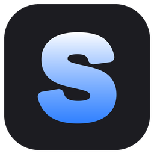
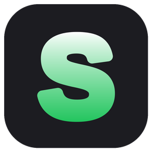
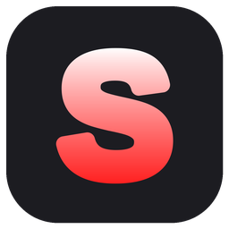

<p align="center">
  <b>English</b> · <a href="README.es.md">Español</a>
</p>

<p align="center">
  
  
  
</p>

# SyncDood — keep your saves and states in sync across PCs

> **Version 0.1** · Follows the Windows language (English / Spanish).

SyncDood keeps your game save folders (saves) and save-state folders (states) identical on all your PCs using your cloud. It lives in the system tray and has a window where you can see the history and change folders, cloud and options **without editing any file**. Built with RetroArch in mind, but it works with any folder.

**Pieces:** [rclone](https://rclone.org) (two-way sync with `bisync`) + an AutoHotkey v2 script (tray icon, timers, sleep detection and the window).
**Resources:** idle, the script uses a few MB and almost 0% CPU. `rclone` only runs while syncing and closes by itself.

## Installation

Do this **on every PC** you want to sync. No administrator rights needed.

1. Unzip the `SyncDood` folder anywhere.
2. Double-click **`Install.bat`**. It downloads rclone and AutoHotkey v2 (portable, inside the same folder) and opens the app.
3. The wizard asks, in order:
   - your **SAVES** folder,
   - your **STATES** folder,
   - *(optional)* any other folders you want to add (for example, another emulator's),
   - your **cloud**. You pick from a list and the wizard shows **only what that cloud needs**; for the easiest ones you just sign in in the browser once.

   When picking folders the normal Windows dialog opens: you can **type or paste the path** in the address bar at the top.
4. Done: it sets up run-at-startup and does the first sync by itself.

Folders can live in different paths on each PC; what must match across PCs is the **cloud** and the **name** of each folder (`saves`, `states`, or whatever you named the extra ones).

### First sync

This PC is merged with the cloud: whatever exists on only one side is copied to the other, and if a file exists on both, the **newest** wins. The loser is saved in the backups folder, so nothing is lost. You can install on your PCs in any order.

If you prefer one side to always win, change it in the SyncDood window → **Options** → *First sync: who wins*: the newest (default), this PC or the cloud.

## Coming from RSY or SaveSync?

SyncDood is the new name of RSY (and, before that, SaveSync). The first time you open SyncDood, if it finds the old settings (`%LOCALAPPDATA%\RSY` or `%LOCALAPPDATA%\SaveSync`) it moves them to `%LOCALAPPDATA%\SyncDood` and keeps your cloud and folders exactly as they were, so there is nothing to set up again. The run-at-startup shortcut is recreated automatically. Afterwards you can delete the old folder and the old `RSY.exe` / `SaveSync.exe`.

## Which cloud should I pick?

The ones marked ★ are the easiest. Free space is approximate and providers change it from time to time.

| Cloud | What it asks for | Notes |
|---|---|---|
| ★ **OneDrive** | Just sign in | ~5 GB free; comes with Windows. With work or school accounts, if the browser says **"admin approval required"**, your organization blocks outside apps: use another cloud. |
| **Dropbox** | Just sign in | ~2 GB free. |
| ★ **Your cloud app's folder** | Pick a folder | The easy way to use **MEGA** (20 GB free, the most), **Google Drive** (15 GB, shared with Gmail and Photos), iCloud and similar, through their desktop app: no accounts or credentials. See below. |
| Filen *(advanced)* | Email, password and API key | 10 GB free, end-to-end encrypted. Direct connection, no extra app to keep running. Needs rclone 1.73 or newer. See below. |
| **Network folder, NAS or your own server** | Pick a folder (a network path like `\\MyNAS\saves` or a drive like `Z:\saves`) | No accounts or keys; you only need to be able to open the folder from Windows. Use it if you run your own NAS or server. See below. |
| **pCloud** | Just sign in | You start with ~5 GB; reaching ~10 GB means completing tasks or inviting people. |
| **Box** | Just sign in | ~10 GB free; 250 MB max per file on the free plan. |
| Google Drive direct *(advanced)* | Your own client ID and secret | Google is withdrawing rclone's simple access during 2026; see below. |
| Backblaze B2 *(advanced)* | keyID, applicationKey and bucket name | For technical users. |
| Nextcloud / ownCloud *(advanced)* | Server address, username and app password | For your own server or a compatible NAS. |
| Other *(advanced)* | rclone's manual wizard | rclone supports dozens of clouds. Create a remote named `syncdood`. |

All of them must keep the files' modification date (the "newest wins" rule depends on it). MEGA connected directly to rclone, for example, doesn't support it well; if you use MEGA, do it through its desktop app with the *Your cloud app's folder* option.

### Your cloud app's folder (recommended for MEGA and Google Drive)

If you already use your cloud's desktop app, there is nothing else to connect:

1. Install the app (for example *MEGA* or *Google Drive for desktop*) and sign in.
2. In SyncDood choose **Your cloud app's folder** and select a folder inside it. SyncDood creates an `SyncDood` subfolder there.
3. Repeat on every PC with the **same account**.

SyncDood syncs your saves with that folder and the cloud app uploads it to the internet. Two things to watch: the cloud app must be running, and the folder must be available offline (in Google Drive, *Mirror files* mode; in OneDrive, *Always keep on this device*). Changes take a bit longer to reach the other PCs because they depend on two syncs in a row.

### Network folder, NAS or your own server

Good for keeping your saves on your own NAS, another PC or a server, with no cloud involved:

1. Share a folder on the NAS or server (SMB/Samba: the norm on Windows, Synology, QNAP, TrueNAS, Linux with Samba…).
2. Check you can open it from Windows Explorer (`\\MyNAS\saves`) or give it a drive letter.
3. In SyncDood choose **Network folder, NAS or your own server** and select that folder (or paste the path in the address bar). SyncDood creates an `SyncDood` subfolder inside.
4. Repeat on every PC pointing to the **same shared folder**.

If the NAS is off or you're away from your network, the sync fails and is retried on the next round, losing nothing. To reach your server from outside your home you have two options: a VPN into your network (and keep using this option) or install Nextcloud and use the *Nextcloud / ownCloud* option.

### Filen direct (advanced)

SyncDood connects to Filen through rclone, with no desktop app involved. rclone needs three things: your account email, your password and an **API key**. Filen only hands out the API key through its command-line tool, so you do this once per account:

1. Download the [Filen CLI](https://docs.cli.filen.io/) (a single small program; it does not need to stay installed).
2. Log in with it and run the `export-api-key` command. Copy the key.
3. In SyncDood choose **Filen (advanced)** and paste email, password and API key. Repeat on every PC with the same account.

Notes: it needs **rclone 1.73 or newer**; `Install.bat` and `Build.bat` download the current rclone, but if you had an older `rclone.exe` next to the script, replace it. If you change your Filen password you must export the API key again and re-enter the three values in the SyncDood window → *Cloud*.

### Google Drive direct (advanced)

Google is going to charge for rclone's shared app and is withdrawing it during 2026, so connecting directly needs your own credentials:

1. In [console.cloud.google.com](https://console.cloud.google.com) create a project.
2. Enable the **Google Drive API**.
3. *OAuth consent screen*: type **External**, add your email as a test user and **publish the app ("In production")**. If you leave it in "Testing", access expires after 7 days.
4. *Credentials → Create credentials → OAuth client ID* → **Desktop app**.
5. Paste the *client ID* and *secret* in the wizard.

Google may warn "unverified app": it's your own app, continue. If this all sounds like too much, use *Your cloud app's folder* instead.

## Build a single `SyncDood.exe`

If you'd rather hand out **one file** (no Install.bat, no AutoHotkey install, no downloads on the target PC):

1. On a Windows PC, open this folder and double-click **`Build.bat`**.
2. The first time it downloads rclone, AutoHotkey v2 and Ahk2Exe (kept in `build\cache`, so later builds are instant) and compiles.
3. You get **`dist\SyncDood.exe`**. Copy it to any PC and open it: the usual wizard appears.

What's inside: the AutoHotkey runtime, the script, `rclone.exe` and the icons. When opened it unpacks rclone and the icons to `%LOCALAPPDATA%\SyncDood\bin` (only when the .exe changes version). Settings stay in `%LOCALAPPDATA%\SyncDood\`.

The exe's version comes from `AppVersion` at the top of `SyncDood.ahk`; `Build.bat` copies it into the exe's file properties.

Things to keep in mind:

- It weighs about 60 MB, almost all of it rclone.
- Leave the `.exe` in a fixed folder (for example `C:\Programs\SyncDood`): run-at-startup points to wherever it is. If you move it, turn *Run at startup* off and on again.
- To update rclone or change the script, delete `build\cache\rclone.exe` (if you want the newest rclone) and run `Build.bat` again.
- The `.exe` isn't digitally signed: Windows SmartScreen may warn the first time ("More info → Run anyway"), and some antivirus programs wrongly flag AutoHotkey executables. If that happens, add an exception or build it yourself on that PC with `Build.bat`.
- If your network blocks the downloads, put `rclone.exe`, `AutoHotkey64.exe` (v2) and `Ahk2Exe.exe` in `build\cache` and run it again.

## Icons

The logo is an **R** that changes color with the sync state:

| Icon | Meaning |
|---|---|
| Blue | Syncing |
| Green | All synced (the tooltip shows the time and how many files went up ↑ and down ↓) |
| Red | The sync failed (the tooltip says why) |
| Red ↔ amber (blinking) | There is a conflict you haven't reviewed yet; it stops blinking when you open the window |

**Double-click the icon to open the SyncDood window.** Right-click opens the menu: *Open SyncDood*, *Sync now*, open folders/log, *Check for updates*, *About / Credits*, *Support on Patreon*, *Project on GitHub*, *Run at startup* and *Exit*.

## The SyncDood window

A sidebar with seven sections. Everything is configured here; you never need to edit `config.ini`. Changes to folders, cloud and options restart SyncDood by themselves and re-open the window. The theme (light / dark) follows Windows, or pick it in *Options → Appearance*.

- **Status:** the header color sums it up (blue syncing, green up to date, amber conflict, red error), with the last sync, the next check, a bar while it works, the state of each folder (each with its own *Sync* button) and recent activity.
- **History:** the latest 200 events per folder, with a folder filter and colors: ↑ Uploaded (green) · ↓ Downloaded (teal) · ✕ Deleted (grey) · ⚠ Conflict (amber) · ✖ Failed (red).
- **Games:** one card per game (screenshot, emulator and number of states); search by name or emulator and sort A–Z or by most recent. Double-click a game to see its slots (screenshot, date, origin and size of each state). It recognises the states of **RetroArch** (`.state`, `.state1`… `.state.auto` + the `.png` next to each), **DuckStation** (`SLUS-00594_1.sav`, in a `savestates` folder), **PCSX2** (`.p2s`), **Dolphin** (`.s01`–`.s10`), **Azahar** (`.cst`) and **PPSSPP** (`.ppst` + its `.jpg`); add each emulator's states folder in *Folders* like any other. Emulators that save the game as an ID (serial / title ID) show that ID; to show real names open the game and press **Rename game…** (it is saved in `%LOCALAPPDATA%\SyncDood\gamenames.ini`, one `ID=Name` per line, e.g. `SLUS-00594=Final Fantasy VII`; you can also edit that file by hand). **Find names** looks up real names for games that still show an ID (DuckStation via the libretro/Redump list, Dolphin via GameTDB; downloaded only when you press it; your own names always win; Azahar and PPSSPP IDs can only be renamed by hand). **Purge versions…** deletes old state versions both on this PC and in the cloud, after showing how many. Each game shows its slots with screenshot, date and origin (the **name of the PC** that uploaded it; set it in *Options → Name of this PC*, it defaults to the Windows computer name). Select one (or double-click) → **Older versions / Restore…**: it lists the copies SyncDood **already keeps** in the backups (this PC's, and with *Include cloud backups* the cloud's too), each with its screenshot. **Restore** first copies the current state to the backups (so you can undo), makes the chosen version the newest one, and it syncs to your other PCs on the next sync. The only extra thing stored is a small text list, per PC, of which states it uploaded (in the cloud under `_pcs/`, outside your synced folders), which is how the origin name is known.
  - **Emulators without file-based states** (not shown in Games, but their regular game saves do sync by adding their folder in *Folders*): **Ryujinx/Ryubing** and **Cemu** have no save states; neither do **RPCS3** or **Vita3K** (game saves only); **TeknoParrot** depends on each game and has no states; **Xemu** keeps snapshots inside the `.qcow2` virtual disk, not as separate files, so they can't be listed per slot.
- **Empty folders:** they are synced as real folders on clouds that have them (OneDrive, Dropbox, pCloud, Nextcloud, folder/NAS…). **Backblaze B2** has no real folders, so empty ones are ignored there (not created or deleted on either side); emulators recreate the ones they need.
- **Folders:** add more folders, change a local path, remove them, open them, **sync only the selected folder**, edit its **exclusions** or run *First sync / repair*. A folder's name is its subfolder in the cloud and must be the same on all your PCs; the local path can differ.
- **Cloud:** shows the current cloud, lets you **change it** and **test the connection**.
- **Options:** language, appearance, check interval, emulator process, wait after sleep, wait for files being written, who wins on first sync, backups, run at startup, updates and test mode.
- **About:** version, credits and *Check for updates*.

> The history comes from rclone's own log (which files changed on this PC and which on the cloud), so it shows what rclone actually decided. A ↓ means **the cloud had a different version** (usually saved from another PC); if that doesn't add up, check the other PC's history.

### Exclusions

In *Folders → Exclusions…* you write rules, one per line (rclone syntax, case-insensitive):

| Rule | Excludes |
|---|---|
| `*.log` | files by name, in any subfolder |
| `shaders/` | any folder called `shaders` and its contents |
| `/logs/` | only the `logs` folder at the root |
| `/xbox_hdd.qcow2` | one specific file at the root |

There are buttons to pick a file or folder and common suggestions (`*.log`, `shaders/`, `cache/`, `*.qcow2`), and a preview tells you how many files and how much space would stop syncing. Rules can name **whole folders** (`shaders/`, `/collections/`) as well as files. If you edit the rules, the next sync re-lists that folder by itself (it merges, **newest wins**, nothing is deleted). Excluded items are ignored **on both sides and never deleted**: whatever was already in the cloud stays there (delete it by hand to free space). Rules live in `%LOCALAPPDATA%\SyncDood\exclude\<folder>.txt` and are per PC.

## Updates

SyncDood checks the GitHub *Releases* (`kyaaadood/SyncDood`) in the background, at most once a day and silently if there is nothing new. You can also click *Check for updates* in the tray menu or in *About*. If a newer version exists, it offers to open the download page. You can turn it off in *Options*.

### Publishing a new version

The version number lives in **one place**: the `AppVersion` line at the top of `SyncDood.ahk` (currently `AppVersion := "0.1"`). To release a new version:

1. Change `AppVersion` (for example to `"0.2"` for the next release).
2. Create a GitHub *Release* in `kyaaadood/SyncDood` whose tag is the same number with a leading `v` (`v0.2`).
3. Running copies compare that tag with their own `AppVersion` and offer the download page if the tag is newer.

`Build.bat` reads `AppVersion` too and writes it into `SyncDood.exe`'s file properties, so you never edit the `;@Ahk2Exe-SetVersion` line by hand.

## When it syncs

- 15 s after the script starts.
- Every `intervalMin` minutes (5 by default).
- ~20 s after **resuming from sleep** (gives the WiFi time to come back).
- ~3 s after you **close the emulator** (`watchProcess`, `retroarch.exe` by default) to upload the last save/state.
- Manually: tray menu or the window → *Sync now*.
- It syncs **even while the emulator is open**.

If it fails (for example, no internet after waking up), it retries twice 45 s apart before warning you; after that it keeps trying on the normal timer.

## Conflicts and backups

A conflict happens when the same file changed on **both PCs** since the last sync.

1. The **newest** version wins (it keeps its normal name on both PCs).
2. The losing version **is moved to the backups folder**, not lost: `<backupDir>\<folder>\conflicts\<date_time>\...`
3. The tray icon blinks between red and amber (there are no pop-up notifications) and a ⚠ event is added to the History. Opening the SyncDood window counts as reviewed.

In addition, everything the sync **deletes or overwrites** is backed up per day, on the PC (`<backupDir>\<folder>\<yyyy-MM-dd>\`) and in the cloud (`_backup/<folder>/<yyyy-MM-dd>/`).

Local backups clean themselves up after `backupKeepDays` (30 by default), at startup and hourly while syncing. Cloud ones are not removed automatically; clean them by hand once in a while. The automatic cleanup deletes old backups and conflict copies after `backupKeepDays`, but it **never deletes save-state versions** (`.state`, `.state1`, `.state.auto` and their screenshots): those stay in *Older versions* until you remove them with **Games → Purge versions…** (you choose how many days to keep).

> Backups are only created when a **sync replaces or deletes** a file, not every time you save in the emulator, and they are kept **per day**: if the same file is replaced several times in one day, the most recent copy of that day is the one that stays.

To recover something: *Options* → *Open backups* (or tray menu → *Open backups folder*) and copy the file back into place.

## Settings (`config.ini`)

You normally **don't need to touch it**: everything is changed from the SyncDood window. It lives in `%LOCALAPPDATA%\SyncDood\` together with `sync.log` and the `data\` folder (*Open config.ini* button in *Options*; after editing it by hand, Exit and reopen SyncDood).

| Key | What it does | Default |
|---|---|---|
| `language` | `auto` (Windows language), `en` or `es` | `auto` |
| `firstSyncWins` | Who wins on the first sync: `newer`, `local`, `cloud` | `newer` |
| `intervalMin` | Minutes between checks | `5` |
| `watchProcess` | Emulator process; syncs when it closes (empty = off) | `retroarch.exe` |
| `resumeDelaySec` | Seconds to wait after resuming from sleep | `20` |
| `pcName` | Name of this PC, shown as the origin of your states (empty = Windows computer name) | *(empty)* |
| `parallelOverride` | Files transferred at the same time (1-32; checks run at twice that). `0` = automatic: 8 for Backblaze B2, Nextcloud, folder and NAS, 4 for the rest (higher can make Google Drive, OneDrive or Dropbox rate-limit you). Set it in Options (Auto / Manual); changing the cloud goes back to automatic | `0` |
| `maxDeletePct` | Delete protection: a sync that would delete more than this % of a folder's files is stopped before touching anything. A manual *Sync now* shows what would be deleted (this PC / cloud) and asks whether to continue; automatic syncs just leave that folder stopped. `0` = off. Set in Options | `25` |
| `pruneCloudBackups` | `1` also cleans old backups and conflicts in the cloud (`_backup/`), with the same days as `backupKeepDays`, at most once a day. Save-state versions stay, and your synced folders are never touched. On Backblaze B2 it deletes for good instead of hiding the file (so it frees space). Set in Options | `0` |
| `backupDir` | Local backups folder (outside the synced folders) | `%LOCALAPPDATA%\SyncDood\backups` |
| `backupKeepDays` | Days local backups are kept (`0` = forever) | `30` |
| `checkUpdates` | `1` = check for updates on startup | `1` |
| `dryRun` | `1` = test mode, only writes to `sync.log` what it would do | `0` |
| `settleSec` | Seconds a file must stay untouched before syncing (waits up to ~45 s; `0` = don't wait) | `10` |
| `theme` | `auto` (follows Windows), `light` or `dark` | `auto` |
| `pauseWhileRunning` | `1` = no automatic syncs while the watched emulator is open (the sync runs when you close it) | `1` |

With *Your cloud app's folder* the path can differ on each PC; what must match is the cloud account.

## Uninstall and cleanup

SyncDood window → **Options**:

- **Uninstall SyncDood…** removes the run-at-startup shortcut, `%LOCALAPPDATA%\SyncDood` (settings, history, log), the rclone connection to your cloud (the credentials stored on this PC), rclone's sync records for SyncDood and any SaveSync leftovers. It asks separately whether to delete the local backups and the program itself (for loose scripts only SyncDood's own files are removed, never the whole folder; with a custom backups folder only SyncDood's subfolders in it are removed). **It never touches your cloud** (files or its `SyncDood` folder) **nor your saves/states folders.**
- **Clean old SaveSync** deletes only what the old SaveSync left: `%LOCALAPPDATA%\SaveSync`, its startup shortcut, the rclone connection `savesync` and its sync records. If SyncDood is still using the `savesync` connection it keeps it.

The old `SaveSync.exe` (wherever you put it) and the `SaveSync` folder inside your cloud are not deleted automatically; remove them by hand if you no longer need them.

## Troubleshooting

- **Install.bat closes or says it can't run scripts:** the PC's policy may block PowerShell. Put `rclone.exe` next to `SyncDood.ahk`, install [AutoHotkey v2](https://www.autohotkey.com/) and open `SyncDood.ahk` directly.
- **Downloads are blocked:** get `rclone.exe` from [rclone.org/downloads](https://rclone.org/downloads/) and put it next to `SyncDood.ahk`; install AutoHotkey v2 separately.
- **Red icon saying it needs "First sync / repair":** happens if a sync was interrupted at a bad moment or something was moved/deleted by hand in the folders. SyncDood window → *Folders* → *First sync / repair…*.
- **The header shows an error but the text is cut off:** click **Details** (top right of the window) to see the full message and the latest error lines of `sync.log`. The banner color follows the tray icon: green = synced, blue = syncing, amber = conflict, red = error.
- **"cannot find prior Path1 or Path2 listings" in the log:** rclone has no sync record for that folder and cloud (for example after migrating from SaveSync or changing the cloud name). SyncDood now detects it and runs a first sync by itself, which merges both sides and deletes nothing.
- **Conflicts on a state/save while you play (`.syncconflict1`):** the emulator rewrites that file while rclone uploads it, so both sides look "changed". Nothing is lost: your copy (the newer one) stays and the other goes to *backups → conflicts*. To avoid it, SyncDood does **not** sync automatically while `watchProcess` (RetroArch by default) is running and syncs right after you close it (*Options → "Don't sync automatically while the emulator is open"*). You can still press *Sync now* at any time.
- **See the log:** tray menu → *Open log* (`sync.log`, keeps only the last 2 days).
- **Deleting a save by hand** propagates to the other PCs on the next sync (that's how two-way sync works), but it's backed up. If you delete more than 50% of the files at once, rclone refuses to sync as a safeguard.

## Notes

- Your PCs should have their clocks in sync (the "newest wins" rule depends on file dates).
- States are bigger than saves; keep your cloud's space (and the backups') in mind.
- Avoid playing the same game on two PCs at once: the sync detects the conflict, but one of the two sessions will end up only as a backup.
- `rclone bisync` is marked *beta* by the rclone project. It works well with small folders, but keep a separate copy of your saves once in a while.
- The app's texts follow the Windows language: Spanish if Windows is in Spanish, English otherwise (you can force it in *Options*).

## 💛 Credits

Made by **KyaaaDood** with Claude AI. 🤖✨

Follow my work on [GitHub](https://github.com/kyaaadood) and, if you want to support the project, you can do it on [Patreon](https://www.patreon.com/cw/KyaaaDood).

SyncDood uses [rclone](https://rclone.org) (MIT license) and [AutoHotkey v2](https://www.autohotkey.com) (GPLv2); see [THIRD_PARTY_NOTICES.md](THIRD_PARTY_NOTICES.md).

## Regenerate the icons

```
python tools/make_icons.py
```

Requires [Pillow](https://python-pillow.org). It generates `icons/ok.ico`, `syncing.ico` and `error.ico` (and the `.png` files used in this README).
